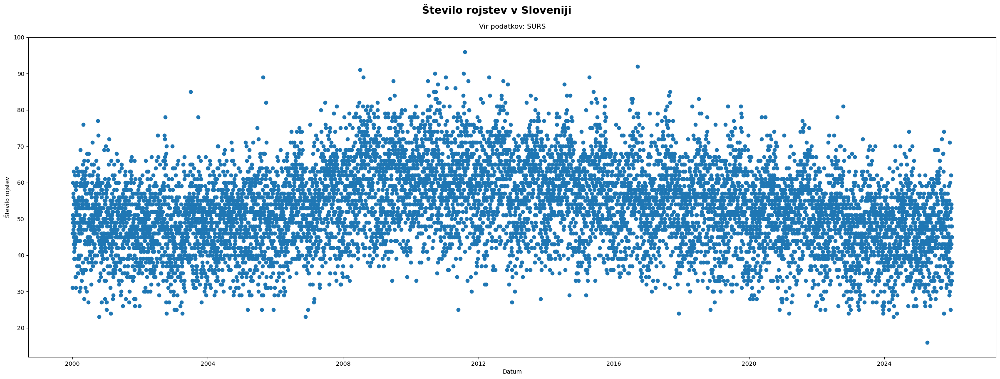
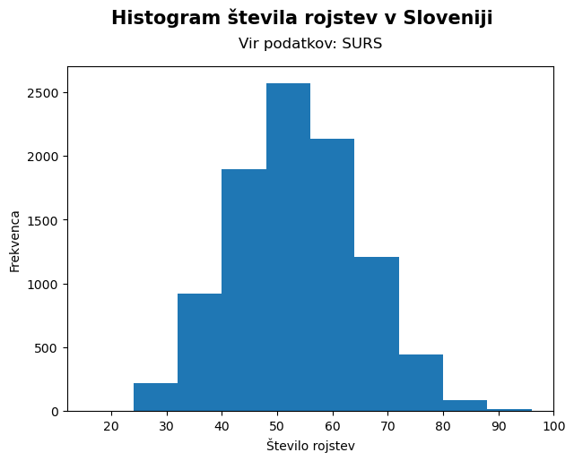
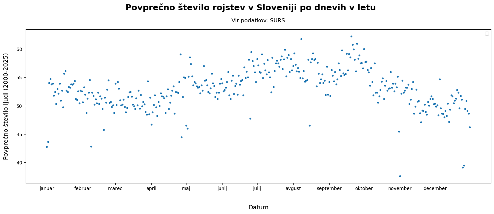
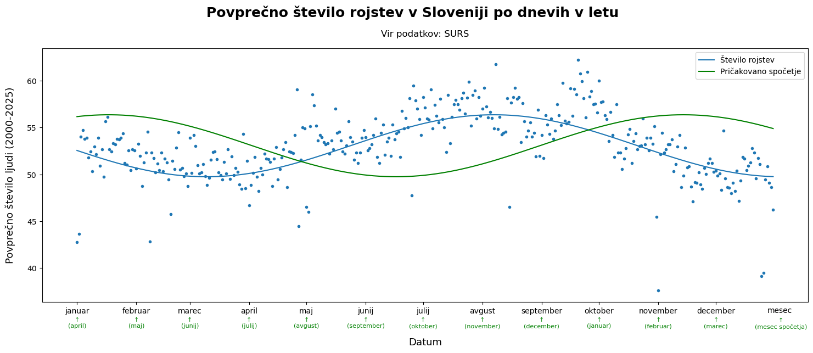
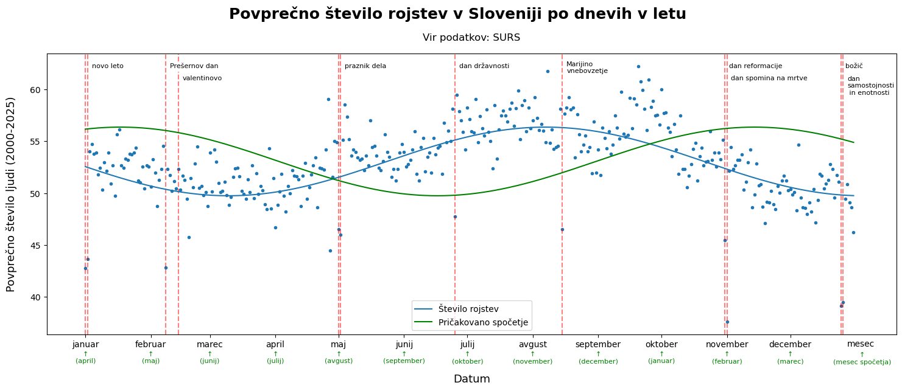
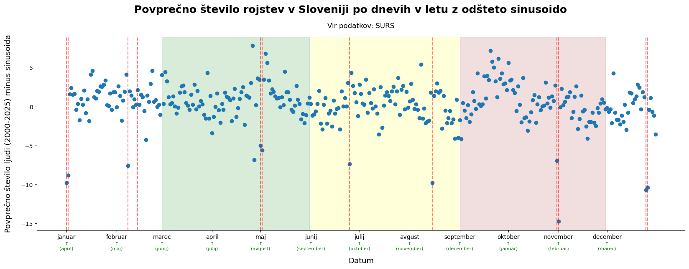
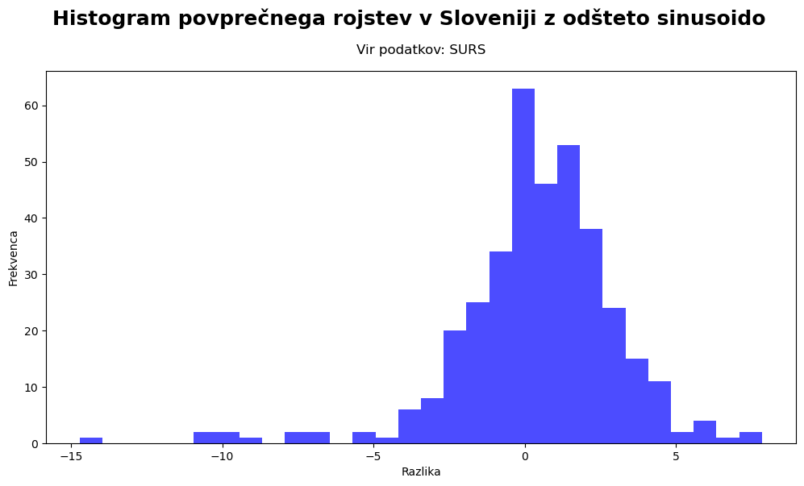
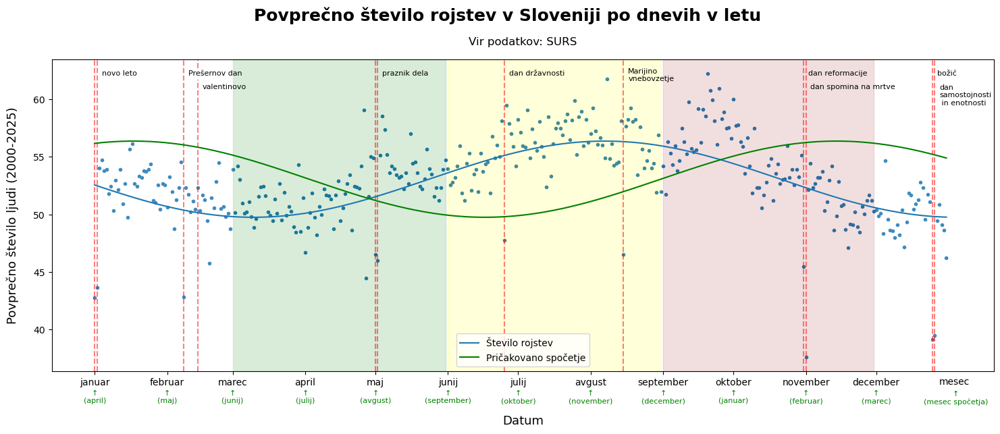

## O čem se gre?

Pri predmetu Interaktivnost in oblikovanje informacij smo za domačo nalogo morali najti neko vizualizacijo in jo oceniti. Jaz sem izbral graf o [številu rojstev v Kanadi](https://www.reddit.com/r/dataisbeautiful/comments/1x7g4th/most_common_birthdates_in_canada_les_dates_de/), ki sem ga našel na redditu.

<blockquote class="reddit-embed-bq" data-embed-theme="dark" style="height:500px" data-embed-created="2026-11-06T15:36:13Z">
<a href="https://www.reddit.com/r/dataisbeautiful/comments/1x7g4th/most_common_birthdates_in_canada_les_dates_de/">Most common birthdates in Canada / Les dates de naissance les plus communes au Canada</a>  by
<a href="https://www.reddit.com/user/StatCanada/">u/StatCanada</a> in
<a href="https://www.reddit.com/r/dataisbeautiful/">dataisbeautiful</a>
</blockquote>

Ta graf prikazuje rank dneva v letu po številu rojstev. S prikazom po kvadratkih vizulizacija spominja na koledar. To jo naredi privlačno, vendar pa otežuje primerjavo med dnevi. Na primer, čeprav se iz vizualizacije lepo prebere, da je 20. september dan z največ rojstvi, ne moremo vedeti velikost razlike. Prav tako pa nam ne da neke zgodbe o rojstvih, ki se jo zagotovo, da najti (z izjemo sezonskosti rojstev). Znan primer je, da je na Valentinovo več spočetij kot druge dni. Pa to velja tudi za kakšen drug dan?

Odločil sem se, da poskusim izboljšati vizualizacijo in jo uporabiti na slovenskih podatkih. Tukaj bom prikazal (delno izmišljeno) pot do končnega prikaza:

## Zgodba prikaza podatkov

Podatke sem prenesel s [SURS-a](https://pxweb.stat.si/SiStatData/pxweb/sl/Data/Data/05J1031S.px).
Začel sem tako, da sem podatke prikazal na preprostem razsevnem grafu.
Vidi se podatke od leta 2000 do 2025. Oblak točk tvori nekakšen "nazobčan valček".

Naredimo še histogram podatkov, da vidimo njihovo porazdelitev.

"Zobčki" predstavljajo sezonskost. Če pogledamo bližje (ali pa povprečimo), vidimo sinusoido, ki se ponovi vsako leto.

Če poračunamo povprečno število rojstev na dan dobim naslednji graf:

Sedaj lahko vidimo, da je večino rojstev med avgustom in septembrom. To si najlažje razložimo tako, da namesto namesto števila rojstev, gledamo število spočetij. Števila spočetij ni v podatkih, zato jih interpoliramo s tem, da sinusoido zamaknemo za 9 mesecev levo. Bom tudi dopisal mesece spočetja, da se ni treba ročno premikati 9 mesecev levo. Zdi se, da je večino spočetij v zimskih mesecih.

Zanimiva so odstopanja od trenda. Še posebej spodnji osamelci. Večino spodnjih osamelcev lahko razložimo z dorisanimi prazniki.

Če bolj podrobno pogledamo graf, lahko vidimo, da so nekje prisotni neki "hribčki".
Zato da lažje ocenimo, ali gre za dejanska odstopanja lahko odštejemo sinusoido in s tem dobimo
"desezonirane" podatke.

Dodatna potrditev za smiselnost sinusoide vidimo s tem, da se podatki (na videz)
porazdeljujejo normalno.

Hribčki so še vedno prisotni. Med njimi najbolj izstopa septemberski. Zdi se mi, da so preostali hribčki razloženi s prazniki, septembrski pa s prazničnim decemberskim vzdušjem.

Na koncu sem se odločil ohraniti peti graf. Sem mu dodal še barvanje po letnih časih.

## Zaključek

S tem zaključimo zgodbo o tem grafu. Seveda, je še mnogo zanimivih smeri, ki bi jih lahko ubrali (primerjava med leti, dnevi v tednu, uporaba verjetnostnega programiranja, itd.). Upam, da je bila tako zanimiva za branje, kot je bilo meni pri risanju grafa.
